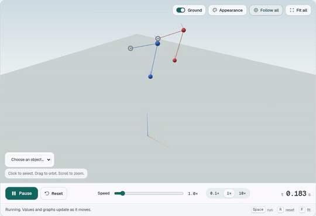
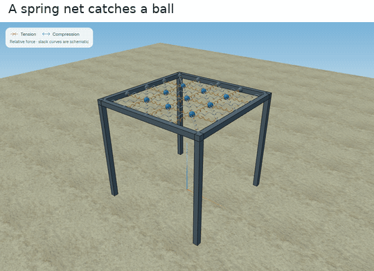

# Physics Lab

Describe a mechanics problem, run a 3D simulation, then change the experiment in conversation.

[Try the demo](https://physics-lab-324399059273.us-central1.run.app)

<p>
  
  
</p>

Recorded from the app's prepared experiments. Open **Examples** to try the double pendulum, spring net, three-body figure eight, frictionless loop or domino cascade without an AI request.

## Use it

1. Describe the situation and press **Build experiment**.
2. Review the paused setup, including its assumptions and any approximation.
3. Press **Run**. Change speed, move the camera, or pause to inspect an object's values and motion graphs.
4. Ask for a change. The next request includes the current experiment so you can revise it without describing everything again.

Objects, joints, springs, friction, collisions and scheduled actions can be combined in one scene. Springs and cords show their current shape and tension/compression cues. The **Ground** switch changes the physical floor; **Appearance** changes its look. The reference grid starts off.

**Open setup** loads a prepared experiment. **Start from prompt** copies its description into an editable draft; it sends nothing until you press Build.

Saved links contain the prompt, assumptions and setup. Each setup change creates a new link. A saved scene expires 24 hours after creation or its latest Run/Resume; opening a link does not extend it. Anyone with the link can read and run that scene.

The hosted AI demo is configured through November 3, 2026 (UTC), subject to provider quota. Prepared-example playback does not use AI.

## Run locally

You need Node.js 24.12 or later in the Node 24 line, plus Docker with its daemon running.

```sh
npm ci --ignore-scripts
npm run build
npm start
```

Open <http://127.0.0.1:3001>. Examples work without an AI key. The first start builds the sandbox image and needs Internet access to download its dependencies.

To generate experiments, configure a provider from [`.env.example`](.env.example). Keep the populated file outside the checkout and link it as the ignored `.env`, or supply the variables through your environment. OpenRouter is the default; OpenAI and Anthropic keys are also supported. Never put credentials in browser code or `VITE_` variables.

Local Connected GPT is optional: with OMP installed and signed in, run `PHYSICS_LAB_CONNECTED_GPT=1 npm start`. The server uses the existing login for GPT-6 Luna with High reasoning. Subscription usage limits apply.

For development, run `npm run api` and `npm run dev` in separate terminals, then open <http://127.0.0.1:5173>. Restart the API after changing credentials. Both API start commands build/cache the Docker worker; restart them after changing worker or shared physics code.

Local saved scenes use SQLite in the OS application-data directory. Set `SCENE_DB_PATH` to use another private location outside the checkout, and keep it consistent across restarts.

## How it works

The AI assembles a typed scene description. MuJoCo computes its motion; Three.js draws it in the browser. A Node server runs the Pi agent with a small set of lab tools inside a disposable Docker container: no network, read-only files, non-root execution and bounded resources. Provider credentials stay in the server.

Before a generated scene opens, the app validates it, initializes the solver, checks the first half-second of motion and requests a separate-context review from the selected model. Models with image input can inspect rendered frames. Failed or canceled updates keep the previous experiment and the draft.

The hosted app uses Cloud Run for the API and private renderer, Firestore for saved scenes, and a private VM for the isolated Docker worker. It does not depend on a tunnel to a developer's machine. Deployment settings, container targets and security boundaries are in the [technical specification](devpost/spec.md#provider-api-and-local-security) and [worker startup script](deploy/worker-startup.sh).

## Limits

This is a mechanics proof of concept. It supports rigid bodies, point particles, joints, springs and ideal cords, not fluids or continuous cloth. The spring net is a discrete network; cord thickness and slack curves are visual approximations.

A valid, runnable model can still misinterpret a prompt. Review the setup before drawing conclusions. The initial motion check does not verify the whole future experiment. Very stiff systems, fast impacts and dense contact scenes can be slow or need further numerical validation. Contact forces can jitter, and the displayed energy values are not a complete energy balance.

AI requests depend on the selected provider's availability and quota. An update is limited to 16 model requests, 24 lab-tool calls and four minutes. These limits do not guarantee a monetary spending cap.

## Development

```sh
npm run sandbox:build
npm test
```

The behavioral suite exercises native MuJoCo motion, physical references, scene validation, persistence, provider boundaries and Docker isolation. It does not need an AI key. Firestore integration tests also need a running emulator specified by `FIRESTORE_EMULATOR_HOST`; those tests skip when it is absent.

The [app map](devpost/app-map.html) points to the main source paths; download and open it locally. [CHANGELOG.md](CHANGELOG.md) records implementation changes.

## Devpost Learn Skill Pack

Built using the official [Devpost Learn Skill Pack](https://github.com/challengepost/learn-ai-basics). The project documents are the [scope](devpost/scope.md), [product requirements](devpost/prd.md), [technical specification](devpost/spec.md) and [build checklist](devpost/checklist.md).

The [installed skills](.agents/skills/) and [source hashes](skills-lock.json) are included. The [first implementation commit](https://github.com/ishkhan42/physics-lab/tree/4b37d3cea77344c715521a480de15f9655c0de4c) contains both the plans and code; Git history does not separate their creation into distinct planning and implementation commits.

## License

[MIT](LICENSE). Third-party components retain their own licenses, including the [Skill Pack](.agents/skills/LICENSE) and [ground textures](src/assets/environment/LICENSE.txt).
